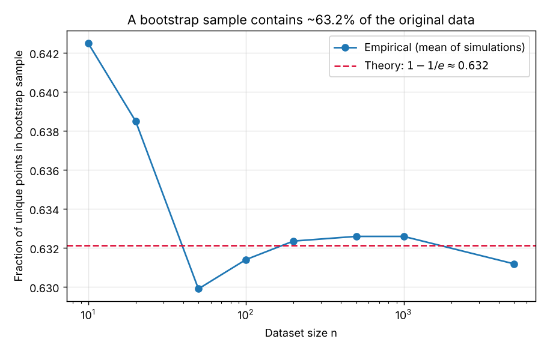
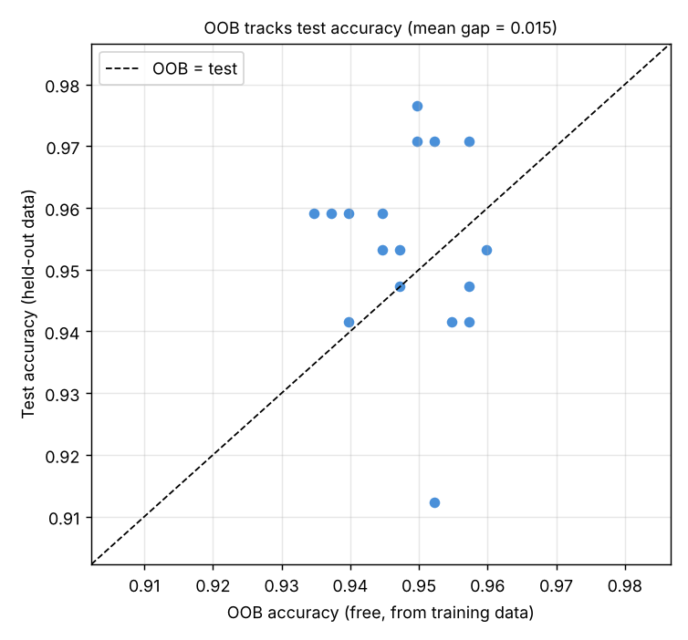
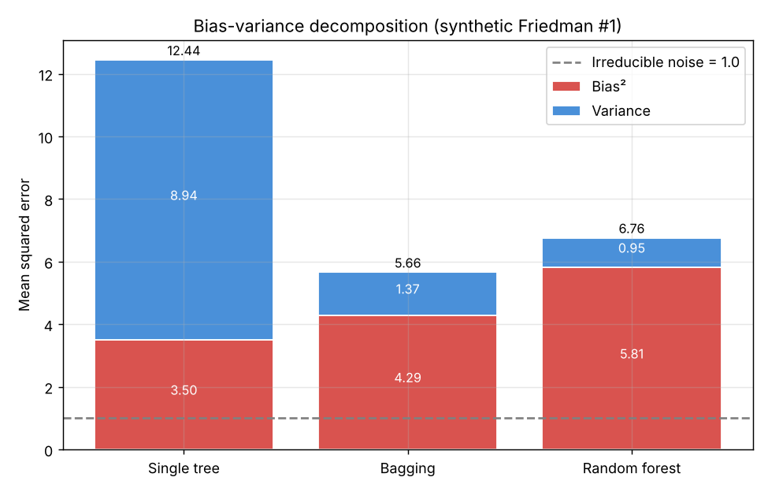
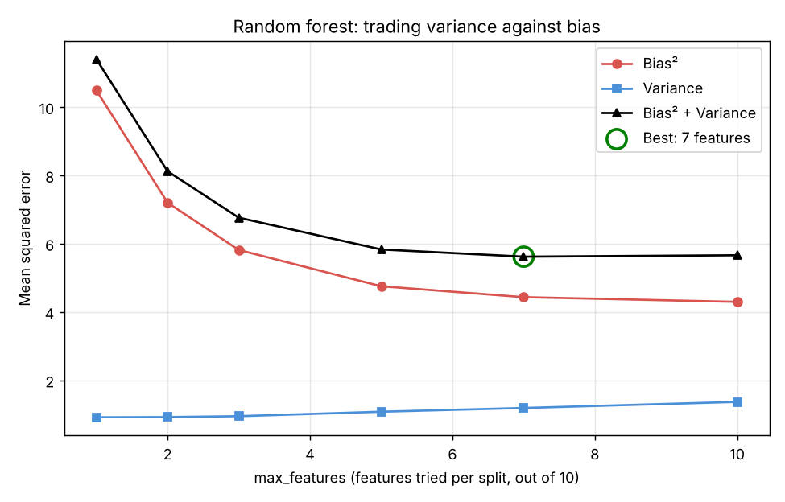
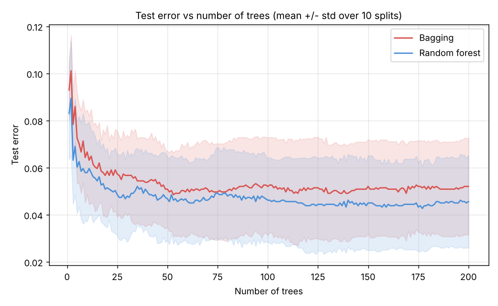
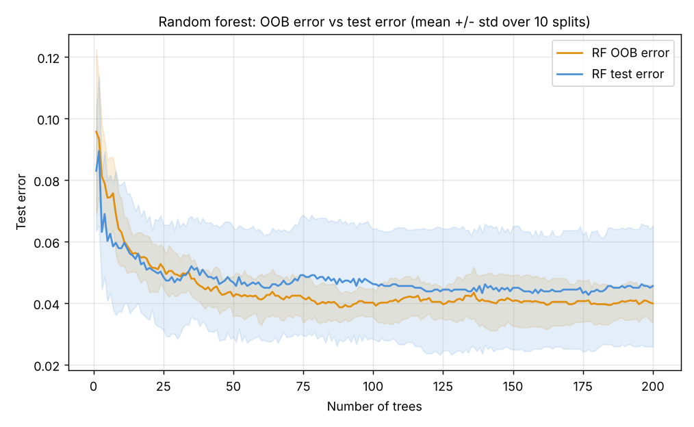

# Bootstrap Ensembles from Scratch

Building bagging and random forests from scratch with NumPy, then studying *why*
bootstrapping reduces variance.

## Project structure

```
bootstrap-ensembles/
├── main.py            # entry point: python main.py
├── data/              # CSV datasets (breast_cancer, wine, diabetes)
├── src/               # core algorithms (bootstrap, bagging, random forest, bias-variance)
├── utils/             # data loading and plotting helpers
├── tests/             # pytest unit tests
├── results/           # generated figures
└── requirements.txt
```

## Quick start

```bash
pip install -r requirements.txt
python main.py        # runs all experiments, saves figures to results/
pytest -q             # runs the unit tests
```

## Progress

- **Initial Working:** Bootstrap fundamentals and the variance problem
- **Previous Working:** Bagging from scratch + out-of-bag error
- **Latest Working:** Random forest + bias-variance analysis
## Initial key findings

**1. A bootstrap sample contains ~63.2% of the original points.**
Each point is missed with probability (1 - 1/n)^n -> 1/e ≈ 0.368. Simulations
from n=10 to n=5,000 converge to the theoretical value (0.6326 at n=1000).
The ~36.8% left out are the **out-of-bag (OOB)** points.



**2. A single decision tree is unstable.**
200 trees trained on different bootstrap resamples of the same Breast Cancer training
set had test accuracy from **0.877 to 0.971** (std 0.019), and disagreed on
**43.9% of test points**.


## Intermediary key findings

I implemented `BaggingClassifier` and `BaggingRegressor` in `src/bagging.py`. Only the base
tree comes from scikit-learn; resampling, hard/soft voting, averaging, OOB estimation and
staged predictions are my own code. Setting `bootstrap=False` gives *pasting*
(sampling without replacement).

**1. Bagging beats a single tree and matches scikit-learn.**
Averaged over 20 random train/test splits on Breast Cancer (50 trees):

| Model | Test accuracy (mean ± std) |
|-------|---------------------------|
| Single decision tree | 0.9243 ± 0.0182 |
| **Bagging (from scratch)** | **0.9535 ± 0.0140** |
| Bagging (scikit-learn) | 0.9526 ± 0.0163 |

Mine is within 0.001 of scikit-learn's, and the spread across splits shrinks (0.018 -> 0.014).


**2. OOB accuracy is a free validation estimate.**
Each tree never sees ~36.8% of the training points, so those points can score it. Across the
same 20 splits, mean OOB accuracy was 0.9486 vs 0.9535 on a held-out test set (mean gap
0.015, max 0.040), without needing a validation split.



**3. Most of the gain arrives within the first ~25 trees.**
On one split (seed 42) the test error fell from 0.070 with 1 tree to 0.023 by 50 trees and then
stayed flat. On that split the test error is lower than OOB error (0.053), a reminder that a
single split is noisy; the 20-split average above is the fair comparison.


**4. Regression (diabetes, 100 trees).**
A single tree overfits badly (test R² = -0.383); bagging reaches R² = 0.386, with OOB R² = 0.475.
The OOB estimate is optimistic here, so on small datasets treat it as a rough guide.

## Latest key findings

I added `RandomForestClassifier` / `RandomForestRegressor` (`src/random_forest.py`) on top of my
bagging code, plus a Monte-Carlo bias-variance decomposition (`src/bias_variance.py`). A random
forest is bagging plus a random subset of features at every split; the per-split draw is done by
the base tree's `max_features`, everything else (bootstrap, voting, OOB, importances) is my code.

**1. Random forest vs bagging on real data (20 splits, 100 trees, soft voting).**

| Dataset | Single tree | Bagging (ours) | Random forest (ours) | Random forest (sklearn) |
|---------|-------------|----------------|----------------------|--------------------------|
| Breast Cancer | 0.9243 ± 0.0182 | 0.9529 ± 0.0182 | 0.9582 ± 0.0152 | 0.9594 ± 0.0153 |
| Wine | 0.8934 ± 0.0364 | 0.9500 ± 0.0334 | 0.9755 ± 0.0208 | 0.9783 ± 0.0149 |

My forest is within 0.003 of scikit-learn's on both datasets. The forest's edge over bagging is
small on Breast Cancer (about half a point, within the split-to-split noise) and larger on Wine (about 2.5 points).


**2. Bias-variance decomposition (synthetic Friedman #1, 100 training sets of 200 points).**
Because the true function is known, the decomposition is exact (a unit test checks that
bias² + variance equals the mean squared error against the truth).

| Model | Bias² | Variance | Bias² + Variance |
|-------|-------|----------|------------------|
| Single tree | 3.50 | 8.94 | 12.44 |
| Bagging (50 trees) | 4.29 | 1.37 | 5.66 |
| Random forest (50 trees, 3 features/split) | 5.81 | 0.95 | 6.76 |

Bagging cuts variance by 85% (8.94 -> 1.37) at the cost of a slightly higher bias, which is the
core idea of the whole project. The random forest reduces variance further, but its bias rises
more, so **on this problem it ends up worse than plain bagging**. Only 5 of the 10 features carry
signal, so restricting a split to 3 random features often leaves out the useful ones.



**3. Sweeping `max_features` shows the trade-off directly.**

| max_features | Bias² | Variance | Total |
|--------------|-------|----------|-------|
| 1 | 10.49 | 0.91 | 11.41 |
| 2 | 7.20 | 0.92 | 8.12 |
| 3 | 5.82 | 0.95 | 6.76 |
| 5 | 4.75 | 1.08 | 5.83 |
| 7 | 4.43 | 1.19 | 5.62 |
| 10 (= bagging) | 4.30 | 1.37 | 5.66 |

Variance falls steadily as fewer features are allowed, but bias climbs faster. The minimum total
error is at 7 features, essentially tied with bagging (5.62 vs 5.66). So the benefit of random
feature subsetting depends on the data, and the default is a starting point, not a guarantee.



**4. Error vs number of trees (Breast Cancer, 10 splits, up to 200 trees).**
Both curves flatten after roughly 50 trees. At 200 trees the mean test error is 0.0456 for the forest
vs 0.0520 for bagging. A paired comparison on identical splits puts the forest ahead by 0.64 points on average,
better or equal in 7 of 10 splits. The shaded bands overlap because they mostly reflect how hard each split is.



**5. OOB error tracks test error.**
At 200 trees the forest's OOB error is 0.0399 vs a test error of 0.0456 (bagging: 0.0465 vs 0.0520).
The mean absolute gap per split is about 0.02, so OOB is a good free estimate but not exact.



**6. Feature importance.** The top features on Breast Cancer are worst perimeter (0.137), worst radius
(0.125), worst concave points (0.124), worst area (0.114) and mean concave points (0.074).
Several of these are strongly correlated (perimeter, radius and area), so impurity-based importances
split credit between them and should not be read as a strict ranking.


## What I learned

- The 63.2% / 36.8% split follows directly from the probability a point is never drawn.
- Unpruned trees fit noise, so small data changes flip many predictions.
- Averaging bootstrap-trained trees cuts variance without any tuning, and OOB error comes for free.
- A single train/test split can mislead; repeated splits give a more honest comparison.
- Bagging mainly attacks variance; random feature subsetting pushes variance down further but
  raises bias, so the best `max_features` depends on how many features are informative.
- Random forest is not automatically better than bagging. It helped on Wine and slightly on
  Breast Cancer, and hurt on a synthetic problem with many irrelevant features at the default setting.

## Module reference

| Item | Location | Purpose |
|------|----------|---------|
| `bootstrap_sample`, `oob_indices` | `src/bootstrap.py` | Resampling and OOB indices |
| `BaggingClassifier` | `src/bagging.py` | Hard/soft voting, OOB score, staged predictions |
| `BaggingRegressor` | `src/bagging.py` | Mean aggregation, OOB R² and MSE |
| `RandomForestClassifier` / `RandomForestRegressor` | `src/random_forest.py` | Bagging + random feature subsets, feature importances |
| `bias_variance_decomposition` | `src/bias_variance.py` | Monte-Carlo bias² / variance / noise on synthetic data |
| `tree_variance_experiment` | `src/variance_demo.py` | Single-tree variance study |
| `load_dataset` | `utils/data_loader.py` | Load a CSV from `data/` |
| `tests/test_bagging.py` | `tests/` | 16 tests incl. comparison with scikit-learn |
| `tests/test_random_forest.py` | `tests/` | 13 tests incl. decomposition identity and variance reduction |
