# Bootstrap and Bagging Ensembles

Bagging and random forests implemented **from scratch in NumPy**, plus experiments on *why* bootstrapping
reduces variance and *how much to trust* the results. Only the base decision tree comes from scikit-learn;
the bootstrap resampling, voting, out-of-bag (OOB) estimation, random-forest logic, bias-variance analysis,
confidence intervals and prediction intervals are my own code, checked against scikit-learn with 48 unit tests.

## Headline results

- **My implementations match scikit-learn.** Accuracy is within 0.003 on Breast Cancer and Wine (20 splits),
  and across six datasets in 5-fold CV no paired bootstrap CI for ours-vs-scikit-learn excludes zero.
- **Bagging removes most of a tree's variance.** On a synthetic problem with a known true function, variance
  fell 85% (8.94 to 1.37) while bias² rose only from 3.50 to 4.29.
- **Random forest is not automatically better than bagging.** With 3 of 10 features per split on that problem
  its total error was *higher* (6.76 vs 5.66). On Digits it won clearly (+2.8 accuracy points).
- **Test metrics need error bars.** 97.7% accuracy on 171 test points has a 95% CI of [95.3%, 99.4%]. The
  bootstrap CI itself covered the truth only 49% of the time at n=20 and reached ~95% by n=200.
- **OOB residual intervals are well calibrated.** Their coverage stayed at 94-96% across noise levels, and
  they were up to 36% narrower than the spread across trees.

<p align="center">
  
  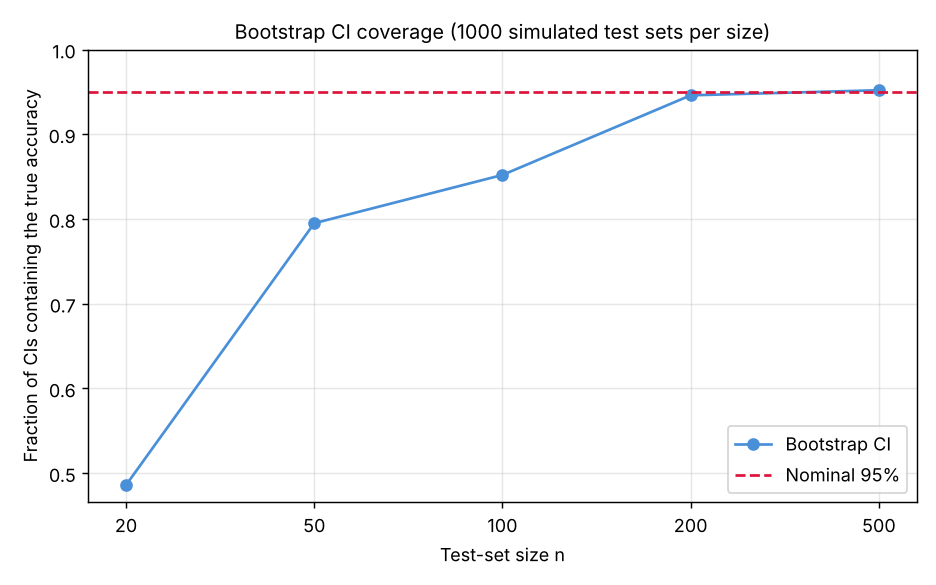
</p>

## Quick start

```bash
git clone https://github.com/Muzammil592/Ensemble_Learning_bagging_bootstrap.git
cd bootstrap-ensembles
pip install -r requirements.txt

python main.py     # all experiments: prints results, writes figures to results/ (about 3 minutes)
pytest -q          # 48 unit tests
```

For a fast guided tour (about 10 seconds of compute), open the demo notebook:

```bash
pip install jupyter
jupyter notebook notebooks/demo.ipynb
```

## Project structure

```
bootstrap-ensembles/
├── main.py                  # entry point: runs every experiment
├── data/                    # CSV datasets (iris, wine, breast_cancer, digits, diabetes, friedman1)
├── src/
│   ├── bootstrap.py         # resampling, OOB indices, the 63.2% rule
│   ├── bagging.py           # BaggingClassifier / BaggingRegressor (voting, pasting, OOB)
│   ├── random_forest.py     # random forests (bagging + random feature subsets)
│   ├── bias_variance.py     # Monte-Carlo bias-variance decomposition
│   ├── uncertainty.py       # bootstrap CIs, paired CIs, prediction intervals
│   ├── bayesian_bagging.py  # Dirichlet-weighted bootstrap (bonus)
│   ├── benchmark.py         # cross-validated out-of-fold predictions
│   ├── metrics.py           # accuracy, RMSE, R^2, ...
│   └── variance_demo.py     # single-tree instability study
├── utils/                   # data loading, k-fold, plotting helpers
├── tests/                   # 48 pytest unit tests
├── notebooks/demo.ipynb     # short guided demo with outputs
├── docs/                    # LinkedIn post and blog post drafts
├── results/                 # generated figures
├── .github/workflows/       # CI: runs the tests on every push
└── requirements.txt
```

## What is from scratch, and what is borrowed

| From scratch (this repo) | Borrowed |
|--------------------------|----------|
| Bootstrap and pasting resampling, OOB bookkeeping | Base decision trees (`sklearn.tree`), including the per-split random feature draw (`max_features`) |
| Hard/soft voting, averaging, staged predictions | scikit-learn bagging / random forest, used only as baselines |
| Random-forest wrapper, feature importances | pandas for CSV loading, matplotlib for plots |
| Bias-variance decomposition, percentile and paired bootstrap CIs | |
| OOB-residual and tree-spread prediction intervals, Bayesian bootstrap, k-fold | |

## Experiments in detail

### Initial stage: key findings

#### Bootstrap fundamentals

**1. A bootstrap sample contains ~63.2% of the original points.**
Each point is missed with probability (1 - 1/n)^n -> 1/e ≈ 0.368. Simulations
from n=10 to n=5,000 converge to the theoretical value (0.6326 at n=1000).
The ~36.8% left out are the **out-of-bag (OOB)** points.


**2. A single decision tree is unstable.**
200 trees trained on different bootstrap resamples of the same Breast Cancer training
set had test accuracy from **0.877 to 0.971** (std 0.019), and disagreed on
**43.9% of test points**.

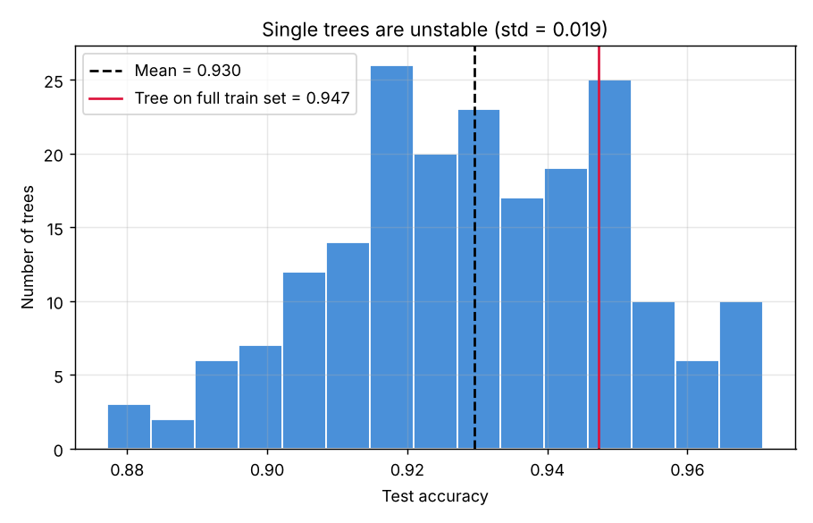

#### Bagging from scratch

I implemented `BaggingClassifier` and `BaggingRegressor` in `src/bagging.py`. Only the base
tree comes from scikit-learn; resampling, hard/soft voting, averaging, OOB estimation and
staged predictions are my own code. Setting `bootstrap=False` gives *pasting*
(sampling without replacement).

**1. Bagging beats a single tree and matches scikit-learn.**
Averaged over 20 random train/test splits on Breast Cancer (50 trees):

| Model | Test accuracy (mean ± std) |
|-------|---------------------------|
| Single decision tree | 0.9243 ± 0.0182 |
| **Bagging (from scratch)** | **0.9535 ± 0.0140** |
| Bagging (scikit-learn) | 0.9526 ± 0.0163 |

Mine is within 0.001 of scikit-learn's, and the spread across splits shrinks (0.018 -> 0.014).

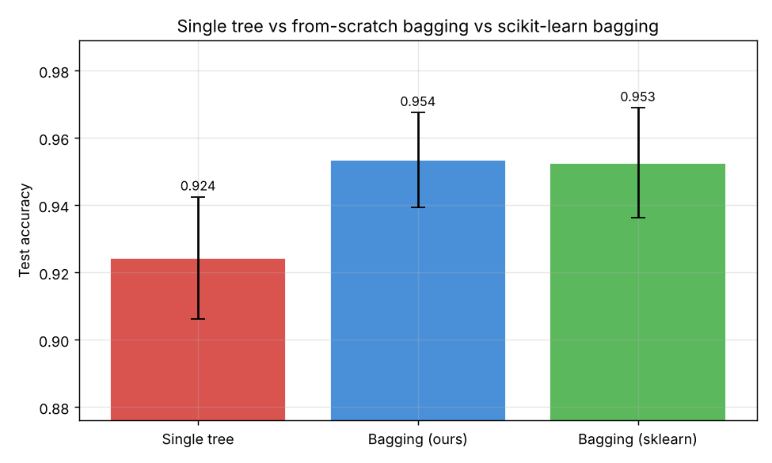

**2. OOB accuracy is a free validation estimate.**
Each tree never sees ~36.8% of the training points, so those points can score it. Across the
same 20 splits, mean OOB accuracy was 0.9486 vs 0.9535 on a held-out test set (mean gap
0.015, max 0.040), without needing a validation split.


**3. Most of the gain arrives within the first ~25 trees.**
On one split (seed 42) the test error fell from 0.070 with 1 tree to 0.023 by 50 trees and then
stayed flat. On that split the test error is lower than OOB error (0.053), a reminder that a
single split is noisy; the 20-split average above is the fair comparison.

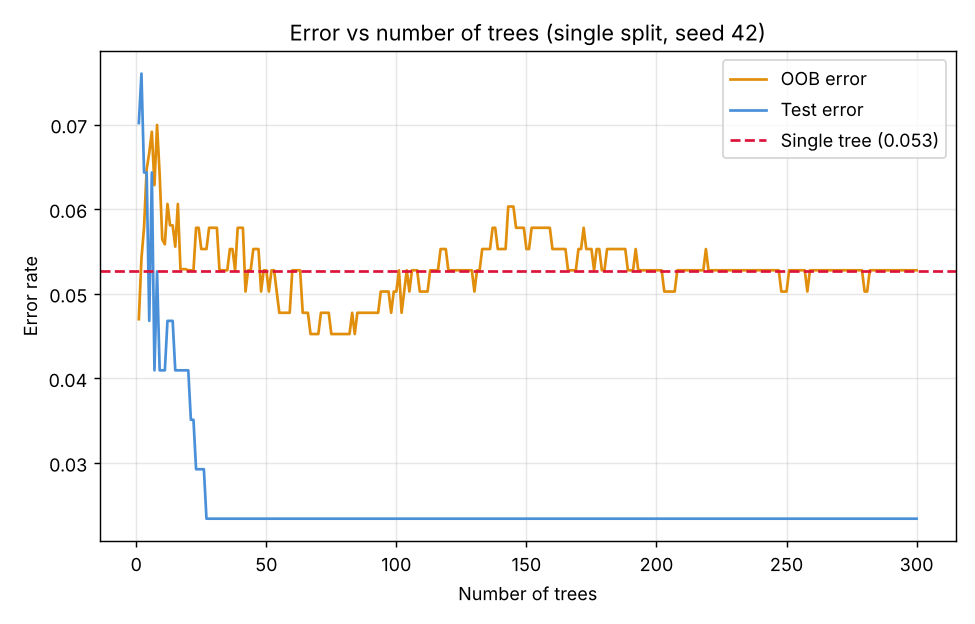

**4. Regression (diabetes, 100 trees).**
A single tree overfits badly (test R² = -0.383); bagging reaches R² = 0.386, with OOB R² = 0.475.
The OOB estimate is optimistic here, so on small datasets treat it as a rough guide.

### Intermediary stage: key findings

I added `RandomForestClassifier` / `RandomForestRegressor` (`src/random_forest.py`) on top of my
bagging code, plus a Monte-Carlo bias-variance decomposition (`src/bias_variance.py`). A random
forest is bagging plus a random subset of features at every split; the per-split draw is done by
the base tree's `max_features`, everything else (bootstrap, voting, OOB, importances) is my code.

**1. Random forest vs bagging on real data (20 splits, 100 trees, soft voting).**

| Dataset | Single tree | Bagging (ours) | Random forest (ours) | Random forest (sklearn) |
|---------|-------------|----------------|----------------------|--------------------------|
| Breast Cancer | 0.9243 ± 0.0182 | 0.9529 ± 0.0182 | 0.9582 ± 0.0152 | 0.9594 ± 0.0153 |
| Wine | 0.8934 ± 0.0364 | 0.9500 ± 0.0334 | 0.9755 ± 0.0208 | 0.9783 ± 0.0149 |

My forest is within 0.003 of scikit-learn's on both datasets. The forest's edge over bagging is
small on Breast Cancer (about half a point, within the split-to-split noise) and larger on Wine (about 2.5 points).

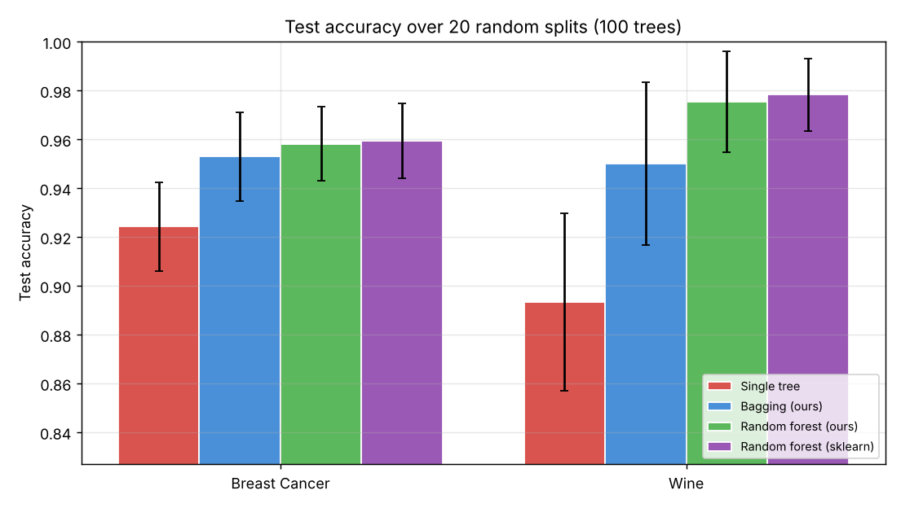

**2. Bias-variance decomposition (synthetic Friedman #1, 100 training sets of 200 points).**
Because the true function is known, the decomposition is exact (a unit test checks that
bias² + variance equals the mean squared error against the truth).

| Model | Bias² | Variance | Bias² + Variance |
|-------|-------|----------|------------------|
| Single tree | 3.50 | 8.94 | 12.44 |
| Bagging (50 trees) | 4.29 | 1.37 | 5.66 |
| Random forest (50 trees, 3 features/split) | 5.81 | 0.95 | 6.76 |

Bagging cuts variance by 85% (8.94 -> 1.37) at the cost of a slightly higher bias, which is the
core idea of the whole project. The random forest reduces variance further, but its bias rises
more, so **on this problem it ends up worse than plain bagging**. Only 5 of the 10 features carry
signal, so restricting a split to 3 random features often leaves out the useful ones.


**3. Sweeping `max_features` shows the trade-off directly.**

| max_features | Bias² | Variance | Total |
|--------------|-------|----------|-------|
| 1 | 10.49 | 0.91 | 11.41 |
| 2 | 7.20 | 0.92 | 8.12 |
| 3 | 5.82 | 0.95 | 6.76 |
| 5 | 4.75 | 1.08 | 5.83 |
| 7 | 4.43 | 1.19 | 5.62 |
| 10 (= bagging) | 4.30 | 1.37 | 5.66 |

Variance falls steadily as fewer features are allowed, but bias climbs faster. The minimum total
error is at 7 features, essentially tied with bagging (5.62 vs 5.66). So the benefit of random
feature subsetting depends on the data, and the default is a starting point, not a guarantee.


**4. Error vs number of trees (Breast Cancer, 10 splits, up to 200 trees).**
Both curves flatten after roughly 50 trees. At 200 trees the mean test error is 0.0456 for the forest
vs 0.0520 for bagging. A paired comparison on identical splits puts the forest ahead by 0.64 points on average,
better or equal in 7 of 10 splits. The shaded bands overlap because they mostly reflect how hard each split is.


**5. OOB error tracks test error.**
At 200 trees the forest's OOB error is 0.0399 vs a test error of 0.0456 (bagging: 0.0465 vs 0.0520).
The mean absolute gap per split is about 0.02, so OOB is a good free estimate but not exact.


**6. Feature importance.** The top features on Breast Cancer are worst perimeter (0.137), worst radius
(0.125), worst concave points (0.124), worst area (0.114) and mean concave points (0.074).
Several of these are strongly correlated (perimeter, radius and area), so impurity-based importances
split credit between them and should not be read as a strict ranking.

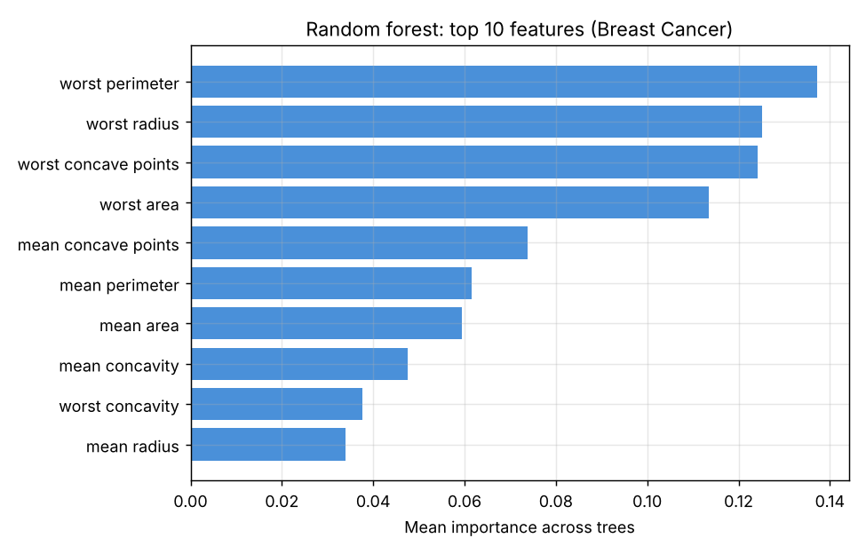

### Final stage: key findings

This stage uses the bootstrap for two kinds of uncertainty: how sure am I about a *reported metric*
(`src/uncertainty.py`: percentile CIs, paired CIs for model differences), and how sure am I about
a *single prediction* (prediction intervals from an ensemble). Benchmarks now use 5-fold
cross-validated predictions on 6 datasets, with a bootstrap CI on every number.

**1. A test metric is an estimate, not a fact.**
The forest's accuracy on 171 Breast Cancer test points is 0.9766 with a 95% CI of
**[0.9532, 0.9942]** (bootstrap SE 0.0114, analytic SE 0.0116). On Diabetes the RMSE of 59.3 has a CI
of [53.4, 65.0] and R² = 0.388 has [0.245, 0.498]. Differences of half a percentage point, like several
in the earlier stages, are well inside this noise.

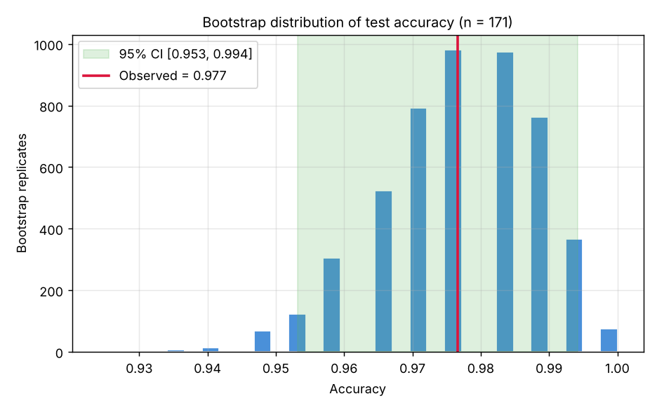

**2. The bootstrap CI is only trustworthy with enough test data.**
I checked it by simulation: draw many test sets from a pool of Digits predictions with known true accuracy
(0.9666) and count how often the 95% CI contains it.

| Test-set size | 20 | 50 | 100 | 200 | 500 |
|---------------|----|----|-----|-----|-----|
| Coverage (1,000 trials each) | 48.6% | 79.5% | 85.2% | 94.6% | 95.2% |

It reaches the nominal 95% only around 200+ test points. At n = 20 a model with 96.7% accuracy gets every
example right about half of the time, which gives a zero-width interval at 100% that misses the truth. That
matches the 49% coverage. With high accuracy and a small test set, a percentile bootstrap CI is badly
over-confident.


**3. Benchmarks with confidence intervals (5-fold CV, 100 trees, accuracy [95% CI]).**

| Dataset | Single tree | Bagging (ours) | RF (ours) | RF (sklearn) |
|---------|-------------|----------------|-----------|--------------|
| iris (n=150) | 0.960 [0.927, 0.987] | 0.953 [0.913, 0.980] | 0.947 [0.907, 0.980] | 0.947 [0.907, 0.980] |
| wine (n=178) | 0.910 [0.865, 0.949] | 0.955 [0.921, 0.983] | 0.972 [0.944, 0.994] | 0.989 [0.972, 1.000] |
| breast cancer (n=569) | 0.926 [0.903, 0.947] | 0.965 [0.949, 0.979] | 0.968 [0.954, 0.982] | 0.963 [0.947, 0.979] |
| digits (n=1797) | 0.851 [0.835, 0.868] | 0.949 [0.939, 0.959] | 0.977 [0.971, 0.984] | 0.975 [0.968, 0.982] |

| Dataset (RMSE, lower is better) | Single tree | Bagging (ours) | RF (ours) | RF (sklearn) |
|---------|-------------|----------------|-----------|--------------|
| diabetes (n=442) | 80.9 [75.3, 86.7] | 60.2 [56.3, 64.1] | 58.1 [54.5, 61.7] | 58.4 [54.7, 61.9] |
| friedman1 (n=1000) | 3.16 [3.01, 3.32] | 2.01 [1.93, 2.10] | 2.08 [1.98, 2.17] | 2.09 [1.99, 2.18] |

Reading these with paired bootstrap CIs on the *difference* (same resamples for both models):
- **Ensembles beat a single tree** on every dataset except iris, where the single tree's 0.960 is within noise of the rest.
- **Random forest vs bagging** is significant on only three datasets: RF is better on Digits (+2.84 points, CI [+1.95, +3.78])
  and Diabetes (RMSE -2.10, CI [-3.34, -0.79]), while **bagging is better on Friedman #1** (RMSE +0.064 for RF,
  CI [+0.017, +0.117]), consistent with the intermediary-stage bias-variance result. On iris, wine and breast cancer the CI includes 0.
- **Ours vs scikit-learn:** no paired CI excludes 0 for either bagging or random forest on any of the six datasets
  (a few sit right at the boundary), so the implementations are statistically indistinguishable here. With 100 trees
  on iris and wine the two even make identical predictions; with 3-10 trees they differ, so this is convergence, not a bug.

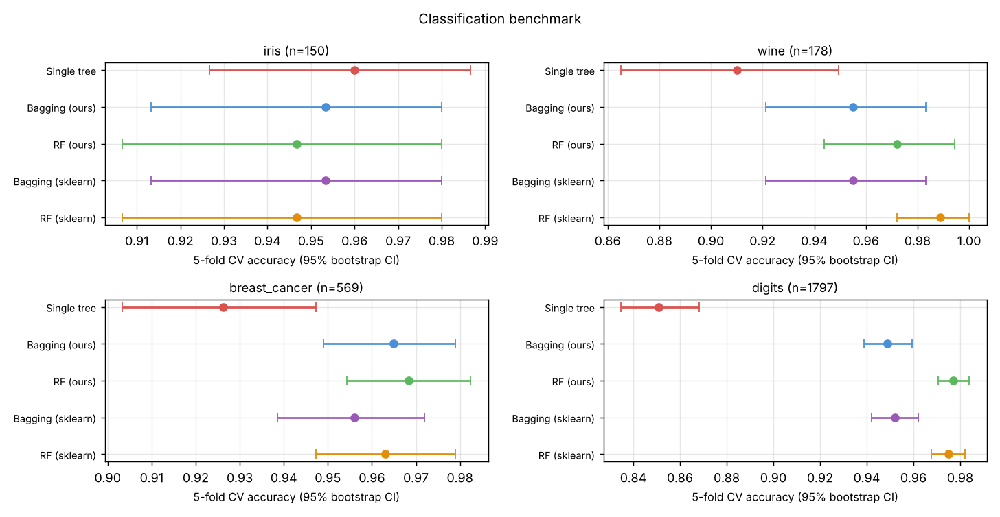
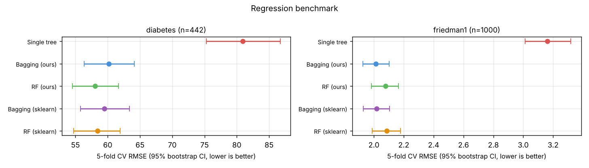

**4. Prediction intervals: spread of the trees vs OOB residuals (95% nominal).**
Two ways to turn a forest into an interval for one prediction: the 2.5-97.5 percentiles of the individual trees'
predictions ("tree spread"), or the forest prediction plus quantiles of the out-of-bag residuals.

| Dataset | Tree spread: coverage / width | OOB residuals: coverage / width |
|---------|-------------------------------|---------------------------------|
| diabetes (20 splits) | 93.4% / 201.8 | 95.1% / 213.9 |
| friedman1 (20 splits) | 98.5% / 12.7 | 94.4% / 8.1 |

A noise sweep on Friedman #1 (500 train / 1,000 test points) shows the pattern:

| Noise sigma | 0.5 | 1 | 2 | 4 | 8 |
|-------------|-----|---|---|---|---|
| Tree spread coverage (width) | 97.9% (12.4) | 97.9% (12.8) | 97.0% (14.5) | 96.1% (20.3) | 93.7% (33.5) |
| OOB residuals coverage (width) | 95.6% (8.4) | 96.0% (9.1) | 94.3% (11.2) | 95.4% (18.6) | 96.2% (35.7) |

The OOB-residual interval stays within about 94-96% at every noise level. The tree-spread interval is not
designed to be a prediction interval, but it ends up roughly calibrated because unpruned trees memorise the
noise. It is conservative when noise is low (about 48% wider at sigma = 0.5) and starts to under-cover at the
highest noise and on Diabetes. I expected tree spread to under-cover everywhere; the data showed otherwise.

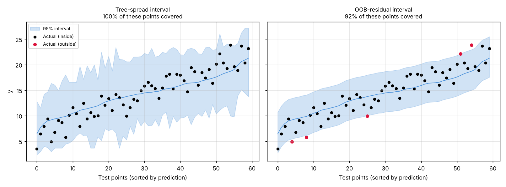
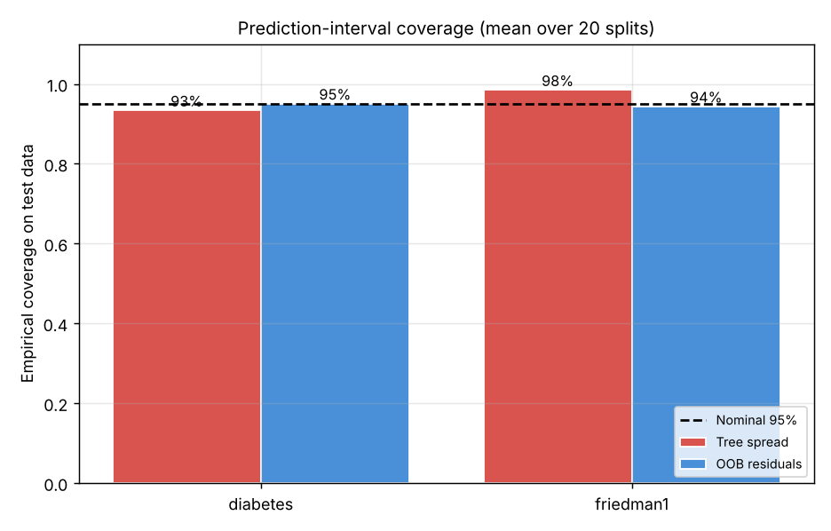

**5. Bonus: bootstrap vs pasting vs Bayesian bootstrap (5-fold CV accuracy).**

| Scheme | iris | wine | breast cancer | digits |
|--------|------|------|---------------|--------|
| Bootstrap (with replacement) | 0.953 | 0.955 | 0.965 | 0.949 |
| Pasting, 63.2% without replacement | 0.953 | 0.949 | 0.960 | 0.945 |
| Pasting, 80% without replacement | 0.960 | 0.933 | 0.951 | 0.925 |
| Bayesian bootstrap (Dirichlet weights) | 0.953 | 0.955 | 0.960 | 0.958 |

Pasting at 63.2% is never significantly different from the bootstrap. Pasting at 80% is worse on Breast Cancer
(-1.41 points, CI [-2.64, -0.17]) and Digits (-2.39 points, CI [-3.23, -1.50]); a plausible reason is that
larger subsamples make the trees more alike, but I did not test that. The Bayesian bootstrap is significantly
better than the ordinary bootstrap only on Digits (+0.89 points, CI [+0.22, +1.56]) and cannot give OOB
estimates because every point is used in every tree.

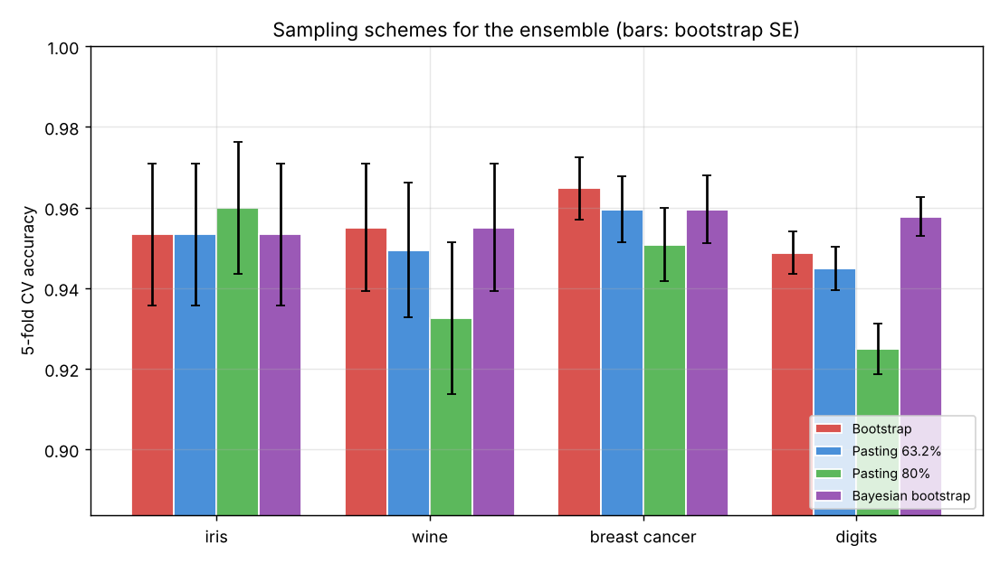

## Limitations

- Only percentile bootstrap intervals are implemented (no BCa), and they are unreliable for small test sets when accuracy is high (see the coverage experiment).
- Benchmarks use a single 5-fold CV partition (seed 42). CIs built from pooled out-of-fold predictions ignore fold-to-fold model variation, so they are slightly optimistic.
- Datasets are small, bundled with scikit-learn, plus one synthetic set. Titanic and California Housing were not used because they need a download; to add a dataset, save it as `data/<name>.csv` with a `target` column and call `load_dataset("<name>")`.
- Impurity-based feature importances split credit between correlated features and should not be read as a strict ranking.
- The per-split feature subsampling inside random forests is performed by scikit-learn's tree, not by my own tree implementation.

## What I learned

- The 63.2% / 36.8% split follows directly from the probability a point is never drawn.
- Unpruned trees fit noise, so small data changes flip many predictions.
- Averaging bootstrap-trained trees cuts variance without any tuning, and OOB error comes for free.
- A single train/test split can mislead; repeated splits give a more honest comparison.
- Bagging mainly attacks variance; random feature subsetting pushes variance down further but
  raises bias, so the best `max_features` depends on how many features are informative.
- A test-set metric needs an error bar. Bootstrap CIs showed that many small differences I would otherwise
  have reported as wins are noise, and a coverage simulation showed the CI itself fails for small test sets.
- Pairing matters: a paired bootstrap on the difference detects gaps that two overlapping separate CIs hide.
- My intuition about interval coverage was wrong, and the experiment corrected it. Measure, don't assume.
- Random forest is not automatically better than bagging. It helped on Wine and slightly on
  Breast Cancer, and hurt on a synthetic problem where half of the features are irrelevant, at the default setting.

## Code map

| Item | Location | Purpose |
|------|----------|---------|
| `bootstrap_sample`, `oob_indices` | `src/bootstrap.py` | Resampling and OOB indices |
| `BaggingClassifier` | `src/bagging.py` | Hard/soft voting, OOB score, staged predictions |
| `BaggingRegressor` | `src/bagging.py` | Mean aggregation, OOB R² and MSE |
| `RandomForestClassifier` / `RandomForestRegressor` | `src/random_forest.py` | Bagging + random feature subsets, feature importances |
| `bias_variance_decomposition` | `src/bias_variance.py` | Monte-Carlo bias² / variance / noise on synthetic data |
| `tree_variance_experiment` | `src/variance_demo.py` | Single-tree variance study |
| `bootstrap_mean_ci`, `bootstrap_ci`, `paired_bootstrap_diff_ci` | `src/uncertainty.py` | Percentile CIs for metrics and for model differences |
| `coverage_experiment` | `src/uncertainty.py` | Simulation check of CI coverage |
| `tree_spread_interval`, `oob_residual_interval` | `src/uncertainty.py` | Prediction intervals from an ensemble |
| `BayesianBaggingClassifier` / `Regressor` | `src/bayesian_bagging.py` | Dirichlet-weighted bootstrap (bonus) |
| `cv_predict` | `src/benchmark.py` | Out-of-fold predictions for benchmarking |
| `accuracy`, `rmse`, `r2`, ... | `src/metrics.py` | NumPy metrics |
| `kfold_indices` | `utils/data_loader.py` | Stratified k-fold splits |
| `load_dataset` | `utils/data_loader.py` | Load a CSV from `data/` |
| `tests/test_bagging.py` | `tests/` | 16 tests incl. comparison with scikit-learn |
| `tests/test_random_forest.py` | `tests/` | 13 tests incl. decomposition identity and variance reduction |
| `tests/test_uncertainty.py` | `tests/` | 19 tests incl. CI coverage, paired CIs, prediction intervals, k-fold |

## Reproducibility

- Every experiment uses fixed seeds; rerunning `python main.py` reproduces the same printed numbers (I checked this by running the full pipeline twice and diffing the output).
- Developed and run locally with Python 3.12.3, NumPy 2.5.4, pandas 3.0.6, scikit-learn 1.9.1 and matplotlib 3.11.2.
- The CI workflow is configured for Python 3.10, 3.11 and 3.12; I could only run 3.12 locally.
- The notebook's saved outputs were produced by executing its cells in a script harness rather than a live Jupyter kernel; re-running it in Jupyter will give the same code results.